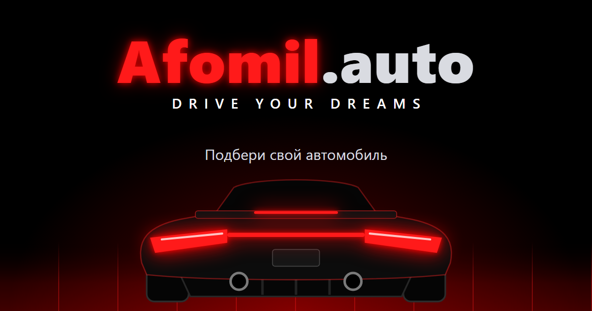

<div align="center">

# 🚗 Afomil.auto

**A dark neon-red link-in-bio landing page with a cinematic car-in-a-tunnel loader.**

[](https://developer.mozilla.org/docs/Web/HTML)
[](https://developer.mozilla.org/docs/Web/CSS)
[](https://developer.mozilla.org/docs/Web/JavaScript)
[](LICENSE)

[Live Demo](https://tonxetyz.github.io/afomil-auto-site/) · [Features](#-key-features) · [Getting Started](#-getting-started) · [Project Structure](#-project-structure)

---



---

</div>

## ✨ Key Features

- 🎬 **Cinematic loader** — a pure CSS 3D tunnel: the car drives forward, wall lights fly by, speed and camera shake build up, then a red flash.
- 🌌 **Animated background** — drifting red smoke, neon speed lines and pulsing tail lights.
- 🔗 **Link buttons** — glassmorphism cards with hover glow, press vibration and staggered entrance.
- ⚡ **One clear CTA** — breathing red button that opens the Telegram bot.
- ♿ **Accessible** — reduced-motion support, keyboard focus, WCAG-AA contrast.
- 🔍 **SEO-ready** — Open Graph / Twitter cards, JSON-LD, sitemap, robots, favicons, custom 404.
- 🍪 **Compliance** — cookie banner (analytics only after consent), privacy policy, terms.

## 🛠️ Tech Stack

| Technology | Used for |
|---|---|
| HTML + CSS | Layout, 3D tunnel, glassmorphism, animations |
| Vanilla JS (~100 lines) | Loader driver, cookie consent, toast |
| GitHub Pages | Hosting |

## 🚀 Getting Started

```bash
git clone https://github.com/Tonxetyz/afomil-auto-site.git
cd afomil-auto-site
npx serve .
```

## 📁 Project Structure

```
├── index.html        # page + inline SVG sprite + loader markup
├── style.css         # all styles
├── app.js            # loader, cookie banner, toast
├── privacy.html      # privacy policy
├── terms.html        # terms of service
├── 404.html          # custom not-found page
└── *.png / *.svg     # favicons, OG image
```

---

<div align="center">

Built with ⚡ by [Tonxetyz](https://github.com/Tonxetyz)

</div>
